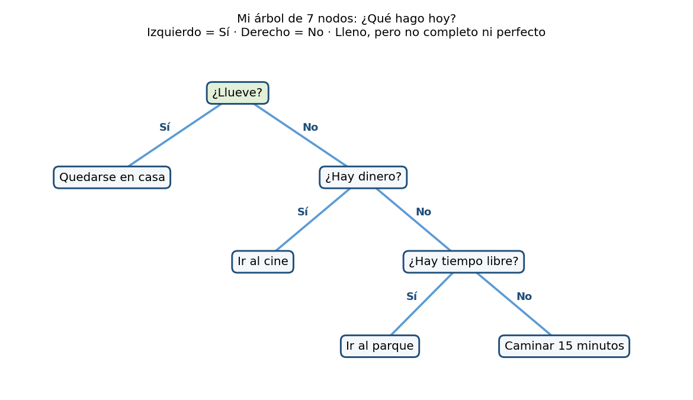
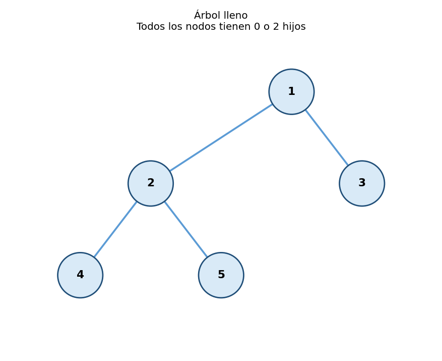
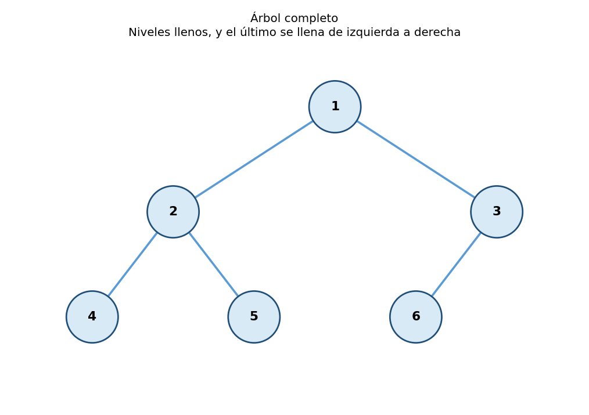
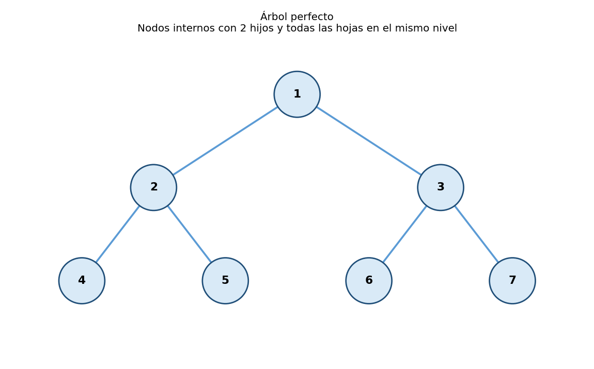
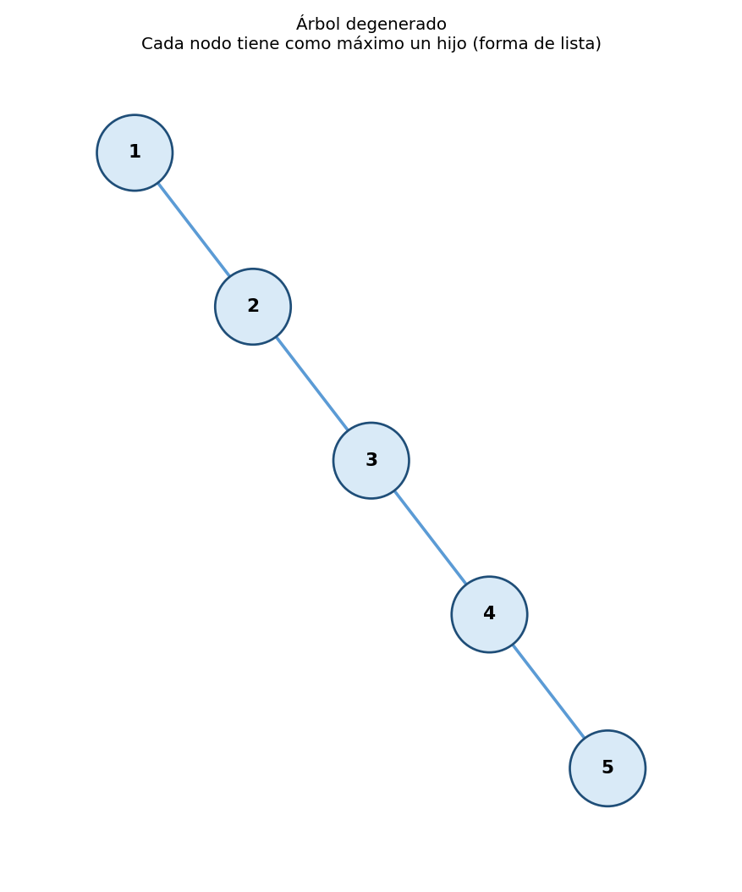

# Guía 3 – Árbol binario y modelado en Java

**Asignatura:** Estructura de Datos II · **Programa:** Ingeniería de Software · **Semestre:** IV
**Ecosistema:** Java / GitHub
**Autor:** Miguel Ángel Ramírez Pardo

## Objetivo

Diseñar e implementar de forma nativa un árbol binario usando referencias izquierda y derecha en Java, y comprender cómo se representa esa estructura en memoria.

## Contenido de la carpeta

| Archivo | Descripción |
|---|---|
| `NodoArbol.java` | Nodo genérico `NodoArbol<T>` con dato y referencias izquierda/derecha. Incluye `esHoja()` y `grado()`. |
| `ArbolBinario.java` | Guarda la raíz. Implementa `imprimirRaizYHijos()`, `imprimirArbol()`, `contarNodos()`, `contarHojas()`, `altura()` y la clasificación (`esLleno()`, `esCompleto()`, `esPerfecto()`, `esDegenerado()`). |
| `Main.java` | Construye a mano mi árbol de 7 nodos y ejecuta las pruebas, incluido el manejo de `null`. |
| `ArbolExpresion.java` | Ejercicio del árbol de expresiones: `(8 - 2) * 4 + 6 / 3`. |
| `diagramas/` | Diagramas de clasificación en PNG y el archivo editable `arboles-guia3.drawio` (5 páginas). |
| `salida_esperada.txt`, `salida_arbol_expresion.txt` | Salida de cada programa. |
| `capturas/` | Capturas de la ejecución. |

## Mi árbol de 7 nodos

Es un árbol de decisión para elegir qué hacer en el día. **Convención:** el hijo izquierdo es la respuesta "Sí" y el hijo derecho es la respuesta "No".

```text
                    ¿Llueve?
                   /        \
     Quedarse en casa        ¿Hay dinero?
                             /          \
                       Ir al cine     ¿Hay tiempo libre?
                                       /             \
                                Ir al parque    Caminar 15 minutos
```



## Clasificación de mi árbol

| Tipo | ¿Lo es? | Justificación |
|---|---|---|
| Binario | Sí | Ningún nodo tiene más de dos hijos. |
| **Lleno** | **Sí** | Todos los nodos tienen 0 o 2 hijos: las tres preguntas tienen dos hijos y las cuatro respuestas son hojas. |
| Completo | No | El nivel 1 tiene un nodo hoja (`Quedarse en casa`), así que el nivel 2 no está lleno aunque existe un nivel 3. |
| Perfecto | No | Las hojas están en niveles distintos (nivel 1, 2 y 3) y un árbol perfecto de altura 3 tendría 15 nodos. |
| Degenerado | No | La raíz y dos nodos más tienen dos hijos. |

Datos medidos por el programa: **7 nodos, 4 hojas, 3 nodos internos, altura 3 (en aristas), grado de la raíz 2.**

## Modelo en memoria

En Java los objetos viven en el *heap* y las variables guardan **referencias** (la "dirección") hacia ellos, no el objeto completo.

- `new NodoArbol<>("¿Llueve?")` crea un objeto en el heap con tres campos: `dato`, `izquierdo` y `derecho`.
- `izquierdo` y `derecho` son referencias a otros `NodoArbol`. Si no hay hijo, valen `null`.
- `llueve.setIzquierdo(casa)` no copia el nodo `casa`: copia su referencia, por lo que `llueve.izquierdo` y la variable `casa` apuntan al mismo objeto.
- El objeto `ArbolBinario` solo guarda la referencia a la raíz. Todo lo demás se alcanza siguiendo las referencias desde ahí.

```text
 arbol ──► ArbolBinario
              raiz ──► [ ¿Llueve? | izq • | der • ]
                                       │       │
                          ┌────────────┘       └──────────────┐
                          ▼                                   ▼
        [ Quedarse en casa | null | null ]     [ ¿Hay dinero? | izq • | der • ]
                                                              │       │
                                                             ...     ...
```

Si se hace `dinero.setDerecho(null)`, el subárbol de `¿Hay tiempo libre?` deja de ser alcanzable desde la raíz y el árbol pasa de 7 a 4 nodos (se comprueba en `Main`).

## Diferencia entre una referencia `null` y un nodo hoja

- Una referencia **`null`** significa que en esa posición **no existe ningún objeto**. No se le puede pedir nada: llamar un método sobre ella lanza `NullPointerException`.
- Un **nodo hoja** **sí existe** como objeto, con su dato, pero sus dos referencias (`izquierdo` y `derecho`) valen `null`. Es decir, no tiene hijos.

En el código: `esHoja()` devuelve `true` cuando `izquierdo == null && derecho == null`. El nodo `Ir al cine` es una hoja (existe), y su hijo izquierdo es `null` (no existe).

## Cómo evito `NullPointerException`

1. Antes de usar un hijo reviso `if (hijo != null)`, por ejemplo en `imprimirRaizYHijos()`.
2. Los métodos recursivos tienen como caso base `if (nodo == null)`.
3. `ArbolBinario` acepta árbol vacío (`raiz == null`) y responde con un mensaje en vez de fallar.
4. Para saber cuántos hijos tiene un nodo uso `grado()` y `esHoja()`, que ya revisan los `null` internamente.

## Ejercicio: árbol de expresiones

```text
           +
         /   \
        *     /
       / \   / \
      -   4 6   3
     / \
    8   2
```

Los **operadores** son nodos internos y los **operandos** son hojas. `evaluar()` recorre el árbol en posorden: primero evalúa los dos hijos y luego aplica el operador. Valida referencias `null`, operadores sin dos operandos, operadores desconocidos y división entre cero.

```text
=== ÁRBOL DE EXPRESIÓN ===
RAÍZ -> +
   IZQ -> *
      IZQ -> -
         IZQ -> 8
         DER -> 2
      DER -> 4
   DER -> /
      IZQ -> 6
      DER -> 3

Nodos: 9 | Hojas (operandos): 5 | Altura: 3

Resultado de (8 - 2) * 4 + 6 / 3 = 26
```

## Diagramas de clasificación

| Lleno | Completo |
|---|---|
|  |  |

| Perfecto | Degenerado |
|---|---|
|  |  |

El archivo `diagramas/arboles-guia3.drawio` se abre y se edita en [app.diagrams.net](https://app.diagrams.net).

## Cómo compilar y ejecutar

Requiere JDK 8 o superior.

```bash
javac -encoding UTF-8 *.java
java Main
java ArbolExpresion
```

Si en Windows los acentos salen mal en la consola, ejecuta antes `chcp 65001`.

## Evidencia de ejecución


Salida de `java Main`:

```text
=== RAÍZ E HIJOS ===
Raíz: ¿Llueve?
Hijo izquierdo: Quedarse en casa
Hijo derecho: ¿Hay dinero?

=== ÁRBOL COMPLETO ===
RAÍZ -> ¿Llueve?
   IZQ -> Quedarse en casa
   DER -> ¿Hay dinero?
      IZQ -> Ir al cine
      DER -> ¿Hay tiempo libre?
         IZQ -> Ir al parque
         DER -> Caminar 15 minutos

=== PROPIEDADES ===
Nodos: 7
Hojas: 4
Altura (en aristas): 3
Grado de la raíz: 2

=== CLASIFICACIÓN ===
¿Lleno?      true
¿Completo?   false
¿Perfecto?   false
¿Degenerado? false

=== CONTROL DE NULL ===
¿'Ir al cine' es hoja? true
Hijo izquierdo de 'Ir al cine': null
'Ir al cine' no tiene hijo izquierdo: la referencia es null.

=== PRUEBA: QUITAR UN ENLACE ===
Nodos enlazados a la raíz: 4
Hojas: 2
¿'¿Hay dinero?' es hoja? false
Grado de '¿Hay dinero?': 1
¿Sigue siendo lleno? false

=== ÁRBOL VACÍO ===
El árbol está vacío (la raíz es null).
Nodos: 0
Altura: -1
```
