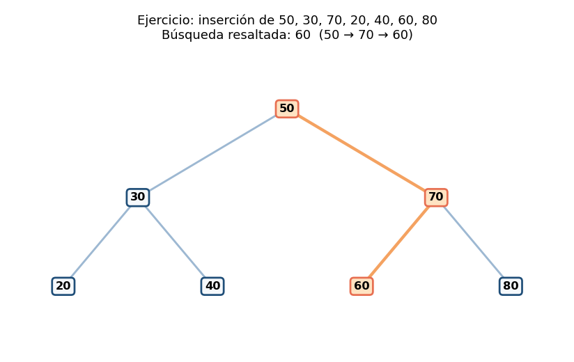
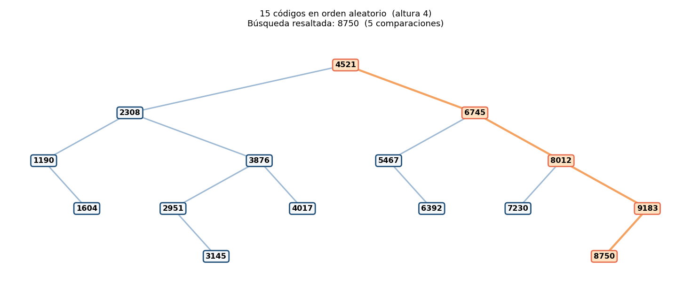
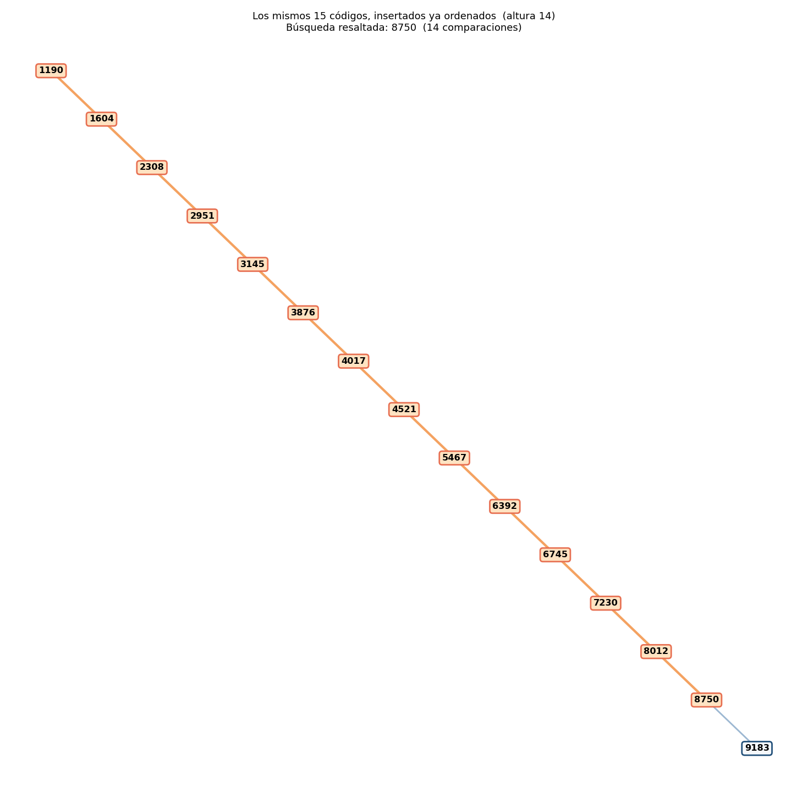
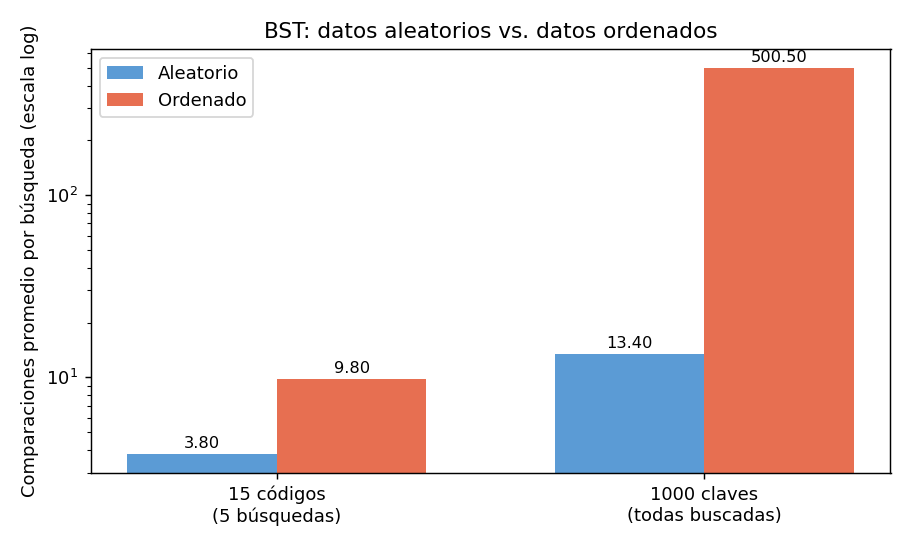

# Guía 4 – BST I: inserción y búsqueda

**Asignatura:** Estructura de Datos II · **Programas:** Ingeniería de Software – Ingeniería de Sistemas · **Semestre:** IV
**Ecosistema:** Java / GitHub
**Autor:** Miguel Ángel Ramírez Pardo

## Objetivo

Implementar inserción y búsqueda recursivas en un Árbol Binario de Búsqueda (BST) y analizar su eficiencia comparando datos en orden aleatorio frente a datos ya ordenados.

## Propiedad BST y convención

Para cada nodo:

- las claves **menores** van en el subárbol **izquierdo**;
- las claves **mayores o iguales** van en el subárbol **derecho** (así, un valor repetido se inserta a la derecha).

Gracias a esa propiedad, buscar o insertar sigue **un solo camino** desde la raíz: en cada nodo se descarta uno de los dos subárboles.

## Contenido de la carpeta

| Archivo | Descripción |
|---|---|
| `NodoArbol.java` | Nodo genérico de la Guía 3, usado como `NodoArbol<Integer>`. |
| `ArbolBST.java` | BST con `insertar()`, `buscar()` (ambos recursivos), `buscarConCamino()`, `comparaciones()`, `altura()`, `inorden()` e `imprimirLateral()`. |
| `ResultadoBusqueda.java` | Guarda si se encontró la clave, las comparaciones y el camino recorrido. |
| `Main.java` | Ejercicio de la guía, escenario aleatorio vs. ordenado, tabla comparativa y experimento con 1000 claves. |
| `diagramas/` | Diagramas PNG, archivo editable `bst-guia4.drawio` (3 páginas) y gráfica comparativa. |
| `salida_esperada.txt`, `comparacion_bst.csv` | Salida del programa y tabla comparativa. |
| `capturas/` | Capturas de la ejecución. |

## Cómo funciona la recursión

**Inserción (`insertarRec`)**
- *Caso base:* si `nodo == null`, se llegó al lugar libre y se devuelve el nodo nuevo.
- *Caso recursivo:* si `valor < nodo.dato` se inserta en el hijo izquierdo; si no, en el derecho. Se devuelve el nodo para volver a enlazarlo.

**Búsqueda (`buscarRec`)**
- *Caso base 1:* `nodo == null` → la clave no existe (`false`).
- *Caso base 2:* `valor == nodo.dato` → se encontró (`true`).
- *Caso recursivo:* se continúa por la izquierda o la derecha según la comparación.

Una **comparación** es cada nodo visitado, es decir, cada vez que se contrasta la clave buscada con el dato de un nodo.

## Ejercicio 1: 50, 30, 70, 20, 40, 60, 80

```text
        50
       /  \
     30    70
    / \   / \
   20 40 60 80
```



Altura 2, 7 nodos. El recorrido inorden sale ordenado: `20 30 40 50 60 70 80`.

## Ejercicio 2: búsqueda de un valor existente y uno inexistente

| Búsqueda | Resultado | Comparaciones | Camino |
|---|---|---|---|
| `60` | Existe | 3 | `50 -> 70 -> 60` |
| `65` | No existe | 3 | `50 -> 70 -> 60 -> null` |

El `65` baja por el mismo camino que el `60`; al pasar de `60` por la derecha encuentra `null`, que indica que ese es el lugar donde se insertaría.

## 15 códigos de productos: aleatorio vs. ordenado

Se insertaron estos 15 códigos en el orden indicado:

```text
4521, 2308, 6745, 1190, 3876, 8012, 5467, 2951, 7230, 1604, 9183, 4017, 6392, 3145, 8750
```

Y luego los mismos 15 códigos ya ordenados de menor a mayor. En ambos casos se hicieron las mismas 5 búsquedas: `1190`, `6392` y `8750` (existen) y `5000` y `9999` (no existen).

| Aleatorio (altura 4) | Ordenado (altura 14) |
|---|---|
|  |  |

### Tabla comparativa

| Escenario | Nodos | Altura (aristas) | Comparaciones totales (5 búsquedas) | Promedio por búsqueda |
|---|---|---|---|---|
| Aleatorio | 15 | 4 | 19 | 3.80 |
| Ordenado | 15 | 14 | 49 | 9.80 |

Detalle de comparaciones por búsqueda:

| Clave | Aleatorio | Ordenado |
|---|---|---|
| 1190 (existe) | 3 | 1 |
| 6392 (existe) | 4 | 10 |
| 8750 (existe) | 5 | 14 |
| 5000 (no existe) | 3 | 9 |
| 9999 (no existe) | 4 | 15 |

Con pocos datos la diferencia ya se nota (3.80 contra 9.80), y a veces el ordenado gana en una búsqueda puntual (la clave `1190` es la raíz). Lo importante es el crecimiento, que se ve en el siguiente experimento.

### Experimento con 1000 claves

Se insertaron 1000 claves (3, 6, 9, …, 3000), una vez mezcladas con semilla fija (`Random(42)`) y otra vez en orden creciente, y se buscó **cada** clave una vez.

| Escenario | Altura | Comparaciones promedio |
|---|---|---|
| Aleatorio | 26 | 13.40 |
| Ordenado | 999 | 500.50 |

Referencias: `log2(1000) = 9.97` y `(n + 1) / 2 = 500.50`.



## Análisis: O(log n) frente a O(n)

**¿Por qué el BST aleatorio es rápido?** En cada comparación se descarta un subárbol completo. Si el árbol está razonablemente equilibrado, su altura es del orden de `log2 n` y buscar o insertar cuesta **O(log n)**. Con 1000 claves aleatorias el promedio fue 13.40 comparaciones, del orden de `log2(1000) ≈ 10` (no es perfecto porque un BST aleatorio no queda perfectamente equilibrado, pero sigue creciendo de forma logarítmica).

**¿Por qué insertar datos ya ordenados degrada el rendimiento?** Cada clave nueva es mayor o igual que todas las anteriores, así que siempre baja por la derecha hasta el final. Ningún nodo llega a tener hijo izquierdo y el árbol queda como una **lista enlazada**: altura `n - 1` (14 con 15 nodos, 999 con 1000). Buscar una clave obliga a recorrer en promedio la mitad de los nodos, `(n + 1) / 2`, por lo que el costo pasa a **O(n)**. Además, insertar los `n` datos cuesta `1 + 2 + … + (n - 1)` comparaciones en total, es decir **O(n²)**.

| Caso | Altura | Búsqueda / inserción |
|---|---|---|
| Equilibrado (mejor caso) | ≈ log2 n | O(log n) |
| Datos aleatorios (caso promedio) | ≈ c · log2 n | O(log n) |
| Datos ordenados (peor caso) | n − 1 | O(n) |

**Conclusión:** el BST simple **no se equilibra solo**; su rendimiento depende del orden en que llegan los datos. Para garantizar O(log n) se usan árboles autobalanceados (AVL, rojinegros).

## Cómo compilar y ejecutar

Requiere JDK 11 o superior.

```bash
javac -encoding UTF-8 *.java
java Main
```

Al ejecutar, el programa también regenera `comparacion_bst.csv`. Si en Windows los acentos salen mal en la consola, ejecuta antes `chcp 65001`.

## Evidencia de ejecución


Salida completa de `java Main`:

```text
=== EJERCICIO: 50, 30, 70, 20, 40, 60, 80 ===
Árbol (lateral, derecha arriba):
            80
      70
            60
50
            40
      30
            20

Inorden: [20, 30, 40, 50, 60, 70, 80]
Altura: 2 | Nodos: 7

Búsqueda de un valor existente y uno inexistente:
Buscar 60 -> ENCONTRADO | comparaciones: 3 | camino: 50 -> 70 -> 60
Buscar 65 -> NO existe | comparaciones: 3 | camino: 50 -> 70 -> 60 -> null
buscar(60) = true | buscar(65) = false

=== 15 CÓDIGOS EN ORDEN ALEATORIO ===
Orden de inserción: [4521, 2308, 6745, 1190, 3876, 8012, 5467, 2951, 7230, 1604, 9183, 4017, 6392, 3145, 8750]
                  9183
                        8750
            8012
                  7230
      6745
                  6392
            5467
4521
                  4017
            3876
                        3145
                  2951
      2308
                  1604
            1190

Buscar 1190 -> ENCONTRADO | comparaciones: 3 | camino: 4521 -> 2308 -> 1190
Buscar 6392 -> ENCONTRADO | comparaciones: 4 | camino: 4521 -> 6745 -> 5467 -> 6392
Buscar 8750 -> ENCONTRADO | comparaciones: 5 | camino: 4521 -> 6745 -> 8012 -> 9183 -> 8750
Buscar 5000 -> NO existe | comparaciones: 3 | camino: 4521 -> 6745 -> 5467 -> null
Buscar 9999 -> NO existe | comparaciones: 4 | camino: 4521 -> 6745 -> 8012 -> 9183 -> null
Total de comparaciones: 19

=== LOS MISMOS 15 CÓDIGOS, YA ORDENADOS ===
Orden de inserción: [1190, 1604, 2308, 2951, 3145, 3876, 4017, 4521, 5467, 6392, 6745, 7230, 8012, 8750, 9183]
                                                                                    9183
                                                                              8750
                                                                        8012
                                                                  7230
                                                            6745
                                                      6392
                                                5467
                                          4521
                                    4017
                              3876
                        3145
                  2951
            2308
      1604
1190

Buscar 1190 -> ENCONTRADO | comparaciones: 1 | camino: 1190
Buscar 6392 -> ENCONTRADO | comparaciones: 10 | camino: 1190 -> 1604 -> 2308 -> 2951 -> 3145 -> 3876 -> 4017 -> 4521 -> 5467 -> 6392
Buscar 8750 -> ENCONTRADO | comparaciones: 14 | camino: 1190 -> 1604 -> 2308 -> 2951 -> 3145 -> 3876 -> 4017 -> 4521 -> 5467 -> 6392 -> 6745 -> 7230 -> 8012 -> 8750
Buscar 5000 -> NO existe | comparaciones: 9 | camino: 1190 -> 1604 -> 2308 -> 2951 -> 3145 -> 3876 -> 4017 -> 4521 -> 5467 -> null
Buscar 9999 -> NO existe | comparaciones: 15 | camino: 1190 -> 1604 -> 2308 -> 2951 -> 3145 -> 3876 -> 4017 -> 4521 -> 5467 -> 6392 -> 6745 -> 7230 -> 8012 -> 8750 -> 9183 -> null
Total de comparaciones: 49

=== TABLA COMPARATIVA (15 códigos, 5 búsquedas) ===
Escenario           Nodos   Altura  Comparaciones   Promedio
Aleatorio              15        4             19       3.80
Ordenado               15       14             49       9.80

(Tabla guardada en comparacion_bst.csv)

=== EXPERIMENTO CON 1000 CLAVES (se busca cada clave una vez) ===
Escenario            Altura  Comparaciones (prom.)
Aleatorio                26                  13.40
Ordenado                999                 500.50
Referencias: log2(1000) = 9.97 | (n + 1) / 2 = 500.50

Conclusión: con datos ordenados el BST se degenera en una lista, su altura llega a n - 1 y buscar pasa de ~O(log n) a O(n).
```
