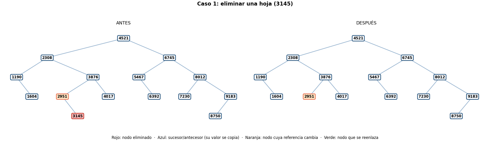
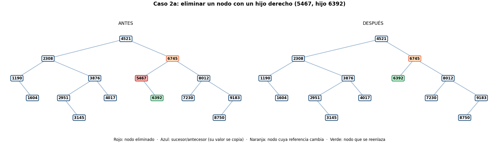
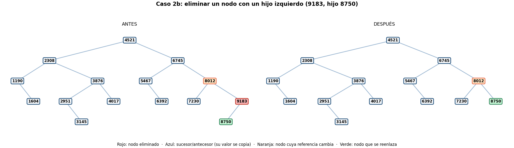
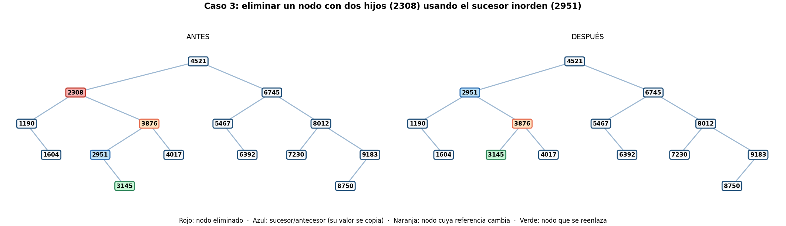
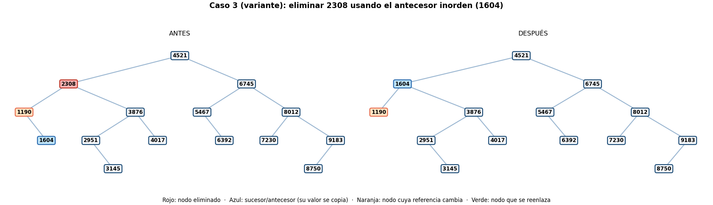
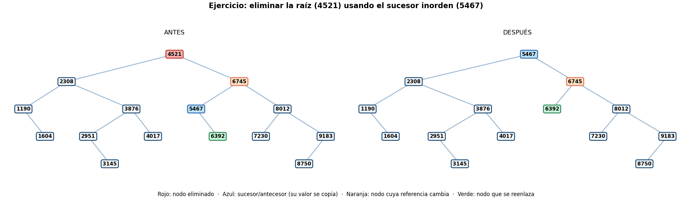

# Guía 5 – BST II: eliminación de nodos

**Asignatura:** Estructura de Datos II · **Programas:** Ingeniería de Software – Ingeniería de Sistemas · **Semestre:** IV
**Ecosistema:** Java / GitHub
**Autor:** Miguel Ángel Ramírez Pardo

## Objetivo

Modificar un BST eliminando nodos sin romper su propiedad de ordenación (menores a la izquierda, mayores o iguales a la derecha).

## Contenido de la carpeta

| Archivo | Descripción |
|---|---|
| `NodoArbol.java` | Nodo genérico de las guías anteriores. Se agrega `setDato()`, necesario para el caso de dos hijos. |
| `ArbolBST.java` | BST de la Guía 4 con `eliminar()`, `eliminarConAntecesor()`, `minValor()`, `maxValor()`, `esBSTValido()`, `buscarNodo()` y `preorden()`. |
| `ResultadoBusqueda.java` | Evidencia de búsqueda de la Guía 4 (camino y comparaciones). |
| `Main.java` | Pruebas de los tres casos, la eliminación de la raíz y pruebas adicionales, con verificaciones automáticas. |
| `diagramas/` | Diagramas antes/después en PNG y el archivo editable `eliminacion-guia5.drawio` (6 páginas). |
| `salida_esperada.txt` | Salida completa de `java Main`. |
| `capturas/` | Capturas de la ejecución. |

## Árbol de prueba

Se parte del BST de la Guía 4: los 15 códigos de producto insertados en este orden.

```text
4521, 2308, 6745, 1190, 3876, 8012, 5467, 2951, 7230, 1604, 9183, 4017, 6392, 3145, 8750
```

```text
                    4521
               /            \
           2308               6745
          /    \             /     \
      1190      3876      5467      8012
         \     /    \         \     /    \
        1604 2951  4017      6392 7230  9183
                \                           /
               3145                       8750
```

Cada prueba trabaja sobre una copia nueva de este árbol. En los diagramas: **rojo** es el nodo eliminado, **azul** el sucesor/antecesor cuyo valor se copia, **naranja** el nodo cuya referencia cambia y **verde** el nodo que se reenlaza.

## Idea general de `eliminar()`

```java
public void eliminar(int valor) {
    raiz = eliminarRec(raiz, valor);
}
```

`eliminarRec` **devuelve la nueva raíz del subárbol** y quien lo llamó vuelve a enlazar ese resultado (`nodo.setIzquierdo(eliminarRec(...))`). Ahí es donde cambian las referencias. Se reasigna `raiz` porque el nodo eliminado puede ser la propia raíz. Si el valor no existe se llega a `null` y el árbol no cambia.

## Los tres casos

### Caso 1: nodo hoja (se elimina 3145)

```java
if (nodo.getIzquierdo() == null) {
    return nodo.getDerecho();   // en una hoja es null
}
```

La hoja devuelve `null`, así que **la referencia del padre hacia ella pasa a `null`**. Aquí, `2951.derecho` pasaba de `3145` a `null`.



### Caso 2: nodo con un hijo

El nodo se **salta**: el padre pasa a apuntar directamente al único hijo del nodo eliminado. Hay dos variantes, según el hijo sea derecho o izquierdo.

```java
if (nodo.getIzquierdo() == null) return nodo.getDerecho();   // solo hijo derecho
if (nodo.getDerecho() == null)   return nodo.getIzquierdo(); // solo hijo izquierdo
```

- **2a, solo hijo derecho (5467):** `6745.izquierdo` pasaba de `5467` a `6392`.
- **2b, solo hijo izquierdo (9183):** `8012.derecho` pasaba de `9183` a `8750`.





### Caso 3: nodo con dos hijos (se elimina 2308)

No se puede "saltar" el nodo porque tiene dos hijos. Se reemplaza su **valor** por el del **sucesor inorden**, que es el mínimo del subárbol derecho (el menor valor mayor que el nodo), y luego se elimina el sucesor original para no dejarlo duplicado.

```java
int sucesor = minValor(nodo.getDerecho());
nodo.setDato(sucesor);
nodo.setDerecho(eliminarRec(nodo.getDerecho(), sucesor));
```

- Sucesor de `2308`: se baja una vez a la derecha (`3876`) y luego siempre a la izquierda hasta `2951`.
- El nodo que contenía `2308` **no cambia de lugar ni de hijos**: solo su dato pasa a ser `2951`.
- Como el sucesor es el mínimo, **nunca tiene hijo izquierdo**, así que su eliminación cae siempre en el caso 1 o en el caso 2a. Aquí `2951` tenía un hijo derecho (`3145`), por lo que `3876.izquierdo` pasó de `2951` a `3145`.
- Se mantiene la propiedad BST porque el sucesor es mayor que todo el subárbol izquierdo y menor o igual que el resto del subárbol derecho.



**Variante con antecesor inorden.** `eliminarConAntecesor()` hace lo mismo con el máximo del subárbol izquierdo. Para `2308` el antecesor es `1604`; el nodo guarda `1604` y `1190.derecho` pasa de `1604` a `null`. Los dos métodos dejan un BST válido; solo cambia qué valor ocupa el lugar.



## Ejercicios de la guía

**1. Completar el caso de dos hijos.** Está en la sección anterior; el código de la guía solo dejaba el comentario de `setDato`, y aquí se completó con `setDato()` y la eliminación del sucesor.

**2. Eliminar la raíz y validar que siga ordenado.** Se eliminó `4521`. Su sucesor es `5467` (se baja a `6745` y luego a la izquierda). La nueva raíz es `5467` y `6745.izquierdo` pasa de `5467` a `6392`. El recorrido inorden sigue ordenado y `esBSTValido()` devuelve `true`. Con el antecesor, la nueva raíz sería `4017`.



**3. Qué referencias cambian en cada caso.**

| Caso | Qué se hace | Referencias que cambian |
|---|---|---|
| Hoja | Se devuelve `null` | La del **padre** hacia el nodo pasa a `null`. |
| Un hijo | Se devuelve el único hijo | La del **padre** pasa a apuntar al **hijo** del nodo eliminado. |
| Dos hijos | Se copia el sucesor y se elimina el sucesor original | El nodo **conserva** sus referencias; cambia su **dato**. Además cambia la referencia del padre del sucesor (a `null` o a su hijo derecho). |

## Validación

`esBSTValido()` revisa la propiedad en **todo** el árbol, pasando a cada nodo los límites que imponen sus ancestros (no basta comparar con el padre). Después de cada prueba se comprueba además que:

- el valor eliminado ya no se encuentra y la cantidad de nodos bajó en uno;
- el recorrido **inorden** sigue ordenado;
- las referencias cambiaron como se esperaba (se imprimen antes y después).

Resultado de las verificaciones de `java Main`:

```text
[OK]    el árbol base es un BST válido
[OK]    3145 ya no existe
[OK]    el padre 2951 quedó con referencia derecha null
[OK]    quedan 14 nodos
[OK]    el árbol sigue siendo un BST válido
[OK]    5467 ya no existe
[OK]    6392 sigue existiendo
[OK]    6745 ahora apunta directo a 6392
[OK]    quedan 14 nodos
[OK]    el árbol sigue siendo un BST válido
[OK]    9183 ya no existe
[OK]    8012 ahora apunta directo a 8750
[OK]    el árbol sigue siendo un BST válido
[OK]    2308 ya no existe
[OK]    el nodo ahora guarda el sucesor 2951
[OK]    el sucesor no quedó duplicado
[OK]    3876 heredó el hijo 3145 del sucesor
[OK]    quedan 14 nodos
[OK]    el árbol sigue siendo un BST válido
[OK]    el nodo ahora guarda el antecesor 1604
[OK]    1190 quedó sin hijo derecho
[OK]    el árbol sigue siendo un BST válido
[OK]    4521 ya no existe
[OK]    la nueva raíz es el sucesor 5467
[OK]    6745 ahora apunta a 6392
[OK]    el inorden sigue ordenado
[OK]    el árbol sigue siendo un BST válido
[OK]    con antecesor la nueva raíz es 4017
[OK]    con antecesor el árbol también es un BST válido
[OK]    eliminar un valor inexistente no cambia el árbol
[OK]    eliminar en un árbol vacío no falla
[OK]    eliminar los 15 códigos uno por uno deja el árbol vacío y válido
[OK]    eliminar el único nodo deja el árbol vacío
[OK]    1000 claves, 500 eliminadas al azar: quedan 500
[OK]    ... el árbol sigue siendo un BST válido
[OK]    ... el inorden coincide exactamente con las claves restantes

Pruebas ejecutadas: 36
Pruebas superadas:  36
Pruebas fallidas:   0
```

Entre las pruebas adicionales hay una con **1000 claves**: se eliminan 500 al azar (semilla fija) y se comprueba que el árbol sigue válido y que su inorden coincide exactamente con las claves restantes.

## Complejidad

Eliminar recorre un camino desde la raíz hasta el nodo y, en el caso de dos hijos, otro hasta el mínimo del subárbol derecho: cuesta **O(h)**, con `h` la altura. Es O(log n) en un árbol razonablemente equilibrado y O(n) si se degenera, como se vio en la Guía 4.

## Cómo compilar y ejecutar

Requiere JDK 11 o superior.

```bash
javac -encoding UTF-8 *.java
java Main
```

Si en Windows los acentos salen mal en la consola, ejecuta antes `chcp 65001`.

## Evidencia de ejecución


La salida completa está en `salida_esperada.txt`.
